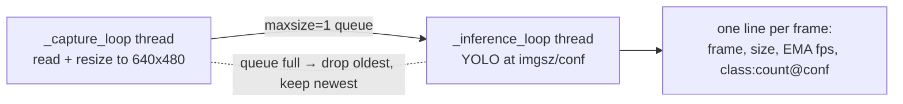

# Architecture

Three entry points, one drivetrain module: `drivetrain.py` holds the L298N pin
constants and the one `TwoChannelMotorController` class — two PWM-enabled gpiozero
`Motor` channels, left and right, steered by differing their speeds.

```mermaid
flowchart LR
  CAM[Camera /dev/video0<br/>V4L2 640x480] -->|BGR frame| LOOP[person_follow.py follow_person loop]
  YOLO[(yolov8n.pt<br/>imgsz 416)] -->|boxes| LOOP
  WD[motor_watchdog thread<br/>MOTOR_WATCHDOG_S 0.75s] -->|stop_all when stale| MOT
  LOOP|drive left/right %| MOT[drivetrain.py TwoChannelMotorController]
  MOT -->|GPIO 23/24/12| L[Left channel: motors 1 & 2]
  MOT -->|GPIO 27/22/13| R[Right channel: motors 3 & 4]
  KEY[raw stdin keystrokes] --> TP[rover.py KeyboardController] --> MOT
  MT[motor_test.py] -->|shared pin constants| L & R
```

## Module shapes

| File | Shape | Importable without side effects? |
| --- | --- | --- |
| `drivetrain.py` | Pin constants plus the one `TwoChannelMotorController`; nothing is constructed at import | Yes |
| `rover.py` | One class, `KeyboardController` (raw-key loop wrapping the shared controller); work happens under `if __name__ == "__main__"` | Yes |
| `motor_test.py` | Flat script; builds two `Motor` objects directly from the shared pin constants rather than reusing the controller class | No — drives the motors on import |
| `person_follow.py` | Config constants, then `load_model()`, `open_camera()`, `follow_person()`, `shutdown()`, `motor_watchdog()`; setup happens in `main()` under `if __name__ == "__main__"` | Yes |
| `detect.py` | `main()` with argparse, plus two nested thread bodies and a signal handler | Yes (guarded) |

Every script that moves the robot imports from `drivetrain.py`, so the controller exists
once. It is built on signed per-side percentages: `drive(left_pct, right_pct)`, with
`move_forward`, `move_backward`, `turn_left`, `turn_right`, `pivot_left` and
`pivot_right` expressed through it, plus `stop_all`, `increase_speed`, `decrease_speed`
and `cleanup`. The same module owns the pin constants and the `GPIO_AVAILABLE` flag.

## GPIO_AVAILABLE fallback

In `drivetrain.py`, the gpiozero import is wrapped in a `try`. If gpiozero is missing,
`TwoChannelMotorController.available` is `False`, the constructor prints one line saying
commands will be logged only, and every motor call then returns early — silently, so the
script's own printed state is the only trace of motion. The rest of the loop still runs,
so the detection, steering maths, and state printing can be exercised on a laptop with no
GPIO. `person_follow.py` imports the flag to print a simulation-mode banner;
`motor_test.py` exits 1 instead of reporting a passed test.

## The follow loop

Nothing opens at import time: `main()` installs the signal handlers, builds the
`TwoChannelMotorController`, loads the weights (`load_model()`), claims the camera
(`open_camera()`) — returning 1 if it will not open — then sets `running = True` and
calls `follow_person()`. Per iteration of that `while running` loop:

1. `frame_count += 1`, then `cap.read()`. On a failed read it warns (once, then every
   20th in a row), calls `robot.stop_all()`, sleeps 50 ms and continues, so a dropped
   camera parks the drivetrain instead of spinning on it.
2. `if FRAME_SKIP > 0 and frame_count % (FRAME_SKIP + 1) != 0: continue`. The committed
   `FRAME_SKIP = 0` infers on every frame; `N` infers every (N+1)th frame.
3. Convert to gray, take the mean, fold into `ambient_light_ema` (seed 120.0,
   alpha 0.1).
4. If the light EMA is below `LOW_LIGHT_THRESHOLD` (72.0) and enhancement is on,
   the frame passed to the network is a CLAHE-boosted copy (details below).
5. At most once per `CAMERA_ADJUST_INTERVAL` (1.0 s), nudge the camera's own gain
   and exposure (`adapt_camera`).
6. Run YOLO with `conf=CONFIDENCE_THRESHOLD`, `imgsz=INPUT_SIZE`, `verbose=False`.
7. Among all returned boxes, keep the single largest one whose class name is
   `person` — area, not confidence, is the selection rule. Fold its confidence
   into `detect_conf_ema` (seed 0.50, alpha 0.15); with no detection, decay it
   toward zero by the same alpha.
8. Steer or search (next two sections).
9. `_beat()` stamps the loop as alive, which re-arms the motor watchdog.
10. Print `>>> ROBOT ACTION: …` only when the state string changes, and print an
    `FPS | Light | ConfEMA` line every 20 inferences.

`motor_watchdog()` runs as a daemon thread started in `main()`: every 0.1 s it calls
`robot.stop_all()` if more than `MOTOR_WATCHDOG_S` (0.75 s) has passed since the last
`_beat()`. A beat happens once per processed frame, including a failed read, so the
timeout only fires when the loop has genuinely stopped issuing commands — stuck in
inference, blocked on a library call — and those cases default to stopped rather than
driving on the last command. The window has to stay above one loop cycle, meaning one
inference plus the `FRAME_SKIP` frames captured between them; the constant's comment
records the Pi 5 at a median 200 ms and p95 250 ms.

## Steering maths

`frame_width` and `frame_height` come from `frame.shape`, so the geometry follows the
frames the camera hands over rather than the requested 640×480. With `x1..y2` the
chosen box:

```
half_width      = frame_width / 2
person_center_x = (x1 + x2) / 2
center_offset   = person_center_x - half_width - MOUNT_OFFSET_PX (0)
steer           = 0                       if |center_offset / half_width| < STEER_DEADBAND (0.08)
                  clamp(center_offset / half_width * TURN_GAIN (0.75), -0.6, +0.6)   otherwise
left_speed      = clamp(FORWARD_SPEED (80) * (1 + steer), MIN_TRACK_SPEED (35), 100)
right_speed     = clamp(FORWARD_SPEED (80) * (1 - steer), MIN_TRACK_SPEED (35), 100)
```

Ultralytics returns boxes in the coordinates of the frame it was given, so a ratio of
`half_width` stays correct at any resolution. `MOUNT_OFFSET_PX` is a fixed pixel bias
subtracted from the raw offset, for a camera that does not point along the centreline.

Positive `steer` means the person sits right of centre, so the left wheel speeds
up and the right slows — the robot arcs right. `STEER_DIRECTION_INVERTED` flips
the sign if the chassis turns the wrong way.

The clamp bounds make tracking an arcing follower rather than a turn-in-place rotator: at
maximum `steer = 0.6` the two sides would want 128 % and 32 %, clamped to 100 % and 35 %,
so both wheels keep driving forward and turning authority comes from that 100/35 ratio.
That is a choice made by these clamps, not a limit of the drivetrain: `drive()` treats a
negative percentage as reverse on that side, and the turning verbs are built from it —
`turn_left` is `drive(-(speed // 2), speed)`, `pivot_left` is `drive(-speed, speed)`.

Two more conditions short-circuit steering:

| Condition | Action | Printed state |
| --- | --- | --- |
| Box height > `TOO_CLOSE_HEIGHT_RATIO` (0.99) × `frame_height` | `stop_all()` | `stopped (too close)` |
| Offset inside the deadband, person near centre | both sides at `FORWARD_SPEED` | `following straight \| left=80% right=80%` |

Because the gate is a share of the real frame height, a resolution change cannot move it
out of range. On the requested 480-line stream it sits at 0.99 × 480 ≈ 475 rows, so it
fires only when the person almost fills the frame: a last-ditch stop, not a standoff. The
constant's comment records a median box height of 459 rows in the current low,
upward-tilted mount, with a person filling the frame from about 1 m out, and says to
remount the camera higher and tilted down before tightening the ratio towards 0.85.
`rover_learning.json` still holds `brake_height_px: 395` and `stop_height_px: 440` from
an earlier two-stage brake design — absolute pixels that no longer map onto a ratio.

## Lost-target search

When no `person` box is found, behaviour is a time-since-last-detection ladder over
`last_seen_direction` (the sign of the last non-zero `steer`):

| Time since last sighting | Condition | Action | Printed state |
| --- | --- | --- | --- |
| ≤ `SEARCH_ALT_START_TIME` (5 s) | last direction known | scan that way at `SEARCH_SCAN_SPEED` (40) | `searching left/right (hold slow)` up to `SEARCH_HOLD_TIME` (1.5 s), then `(extended slow)` |
| > 5 s | last direction known | flip `search_direction` every `SEARCH_ALT_INTERVAL` (6 s) and scan | `alternating search left/right (slow)` |
| any | no direction recorded yet | `stop_all()` and reset the search bookkeeping | `stopped (no person)` |

Hold and extended are one branch: `SEARCH_HOLD_TIME` (1.5 s) only picks which label is
printed, so the motion is a single scan speed until `SEARCH_ALT_START_TIME`.
`search_direction` starts at `-1` and only adopts a `last_seen_direction` that is
non-zero, so sighting a person dead-centre cannot erase the direction an alternating arc
is scanning in, and `search_last_switch_time` is stamped on every followed frame, which
restarts the 6 s alternation clock from the last sighting.

`apply_search_scan()` calls `turn_left` / `turn_right` on the shared controller, which is
`drive(-(speed // 2), speed)`: the inner channel runs **backward** at 20 % while the
outer runs forward at 40 % — a pivot, not an arc. This is where normal following commands
reverse; every search scan backs one wheel up.

`last_seen_direction` starts at `0`, so a robot that has never detected a person
stands still until something enters the frame.

## Adaptive low light

Two independent mechanisms, one image-space and one sensor-space:

- **Image space** — `enhance_low_light()` converts BGR → YCrCb, applies
  `cv2.createCLAHE(clipLimit=2.0, tileGridSize=(8,8))` to the Y channel only, and
  converts back. Applied when `ambient_light_ema < 72.0` and
  `ENABLE_LOW_LIGHT_ENHANCE` is true. The original frame is untouched; only the
  copy fed to YOLO is boosted, and nothing is displayed.
- **Sensor space** — `adapt_camera()` runs at most once per second. If the scene is
  dark **and** `detect_conf_ema < 0.65`, it raises gain by 2.0 (range 0–64) and
  exposure by one step; if the scene is bright (`> 145.0`) it lowers both; in
  between it returns without touching the camera. Exposure ranges depend on the
  sign the driver reports: negative exposure values (the common V4L2 manual
  convention) clamp to −13…−1 with step 1, positive ones to 1…500 with step 5.
  A line prints only when the OS accepted at least one of the two settings, and
  the read-backs are NaN-guarded at startup (gain defaults to 0.0, exposure to −6.0).

## detect.py — the observation-only twin

`detect.py` exists to answer "is the camera pipeline fast enough, and what is the
network seeing", with no motion code at all. Its structure differs from the
follower in ways that matter for measurement:



- Two daemon threads and a one-slot queue. When the queue is full the capture
  thread discards the frame waiting there and inserts the newest, so inference
  always sees the freshest image and latency does not pile up — the price is
  dropped frames, which is the correct trade for a follower.
- `--device` takes an index or a `/dev/video` path (default `/dev/video0`), opened with
  `cv2.CAP_V4L2`, so it selects the camera the way the follower does.
- fps is an exponential moving average (`alpha = 0.15`) of 1 / inference-time, not
  a capture rate. It measures network throughput only.
- Detection output is aggregated per class as `name:count(@top_confidence)`, or
  `none`.
- Device selection is `cuda` when torch reports CUDA available, else `cpu`, with
  `model.model.half()` applied only on CUDA. This machine reports
  torch `2.11.0+cu130` with CUDA unavailable, so everything runs on the CPU.

## Interrupt and shutdown paths

| Script | Mechanism | Cleanup on exit |
| --- | --- | --- |
| `person_follow.py` | `install_signal_handlers()` maps `SIGINT` / `SIGTERM` to `shutdown()`, which is idempotent (`_shutting_down`) and sets `running = False`; `follow_person()` has a `finally` that signals and joins the watchdog; `__main__` keeps an `except KeyboardInterrupt` for an interrupt raised before the handlers were installed | stop motors, `close()` both channels, `cap.release()`; the exit status comes from `main()` — 0 after a normal stop, 1 when no camera would open |
| `rover.py` | `try/except KeyboardInterrupt/finally` around the key loop. Raw mode clears ISIG, so `Ctrl+C` arrives as `0x03` and acts as the exit key; an exhausted stdin stops the motors and leaves the loop | stop, `cleanup()` both channels |
| `detect.py` | `signal.SIGINT` handler prints and exits; `finally` in `main()` releases the camera | release camera, set the stop event, join both threads with a 1 s timeout |
| `motor_test.py` | `except KeyboardInterrupt` and `except Exception` both set `failed`, then `finally` stops and closes both channels | exits 0 only if the whole sequence ran; any error, a Ctrl+C, or an unimportable gpiozero exits 1. The stop is commanded by the script itself — gpiozero's `atexit`-registered `_shutdown` is a backstop, not the mechanism |

That heartbeat is a thread inside the follow process, so it dies with a `SIGKILL` and
does nothing about a brown-out, and `rover.py` and `detect.py` have no timeout of their
own. No script has a hardware kill switch — if the controlling process is `SIGKILL`ed or
the board loses power with the driver enabled, the last PWM state is what the motor rail
sees.
